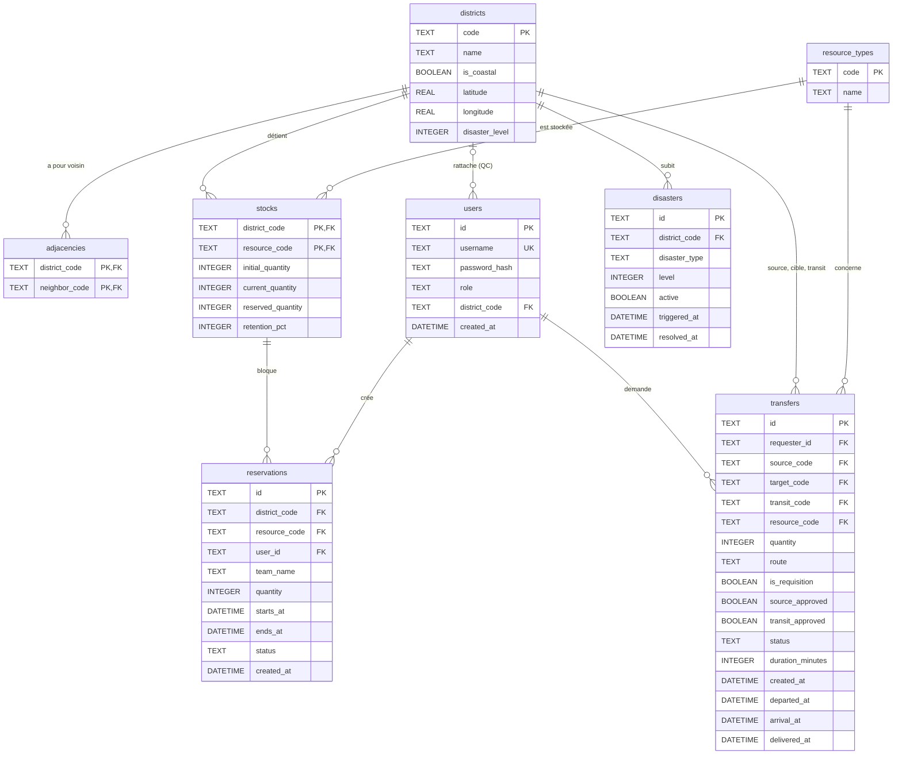

# Diagramme entité-association

- `adjacencies` reprend la matrice d'adjacence terrestre (deux lignes par liaison) ; l'accès maritime vient de `districts.is_coastal`.
- Seuil de rétention d'un stock : `ceil(initial_quantity × retention_pct / 100)`.
- Schéma et données initiales : [`backend/migrations`](../../backend/migrations).
