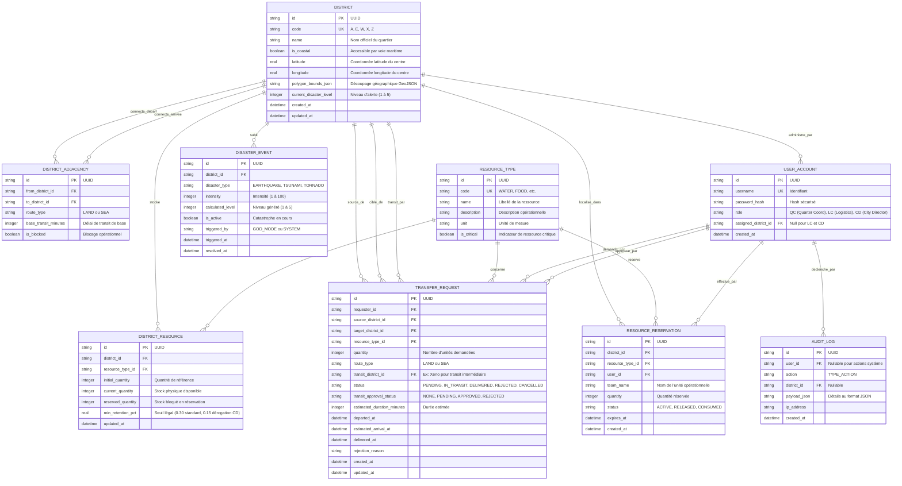

# KAIJU - Crisis Manager : Spécifications et Diagramme Entité-Association (ERD)

## 1. Contexte Opérationnel de Tokyork

En situation de crise imminente, la ville de **Tokyork** est découpée en **5 quartiers stratégiques** aux caractéristiques géographiques et logistiques précises :
- **Apex (Code: A)** : Quartier enclavé (Nord). Aucune façade maritime.
- **Echo (Code: E)** : Quartier portuaire situé sur la baie (Est). Accès maritime direct.
- **Warden (Code: W)** : Quartier enclavé industriel/militaire (Ouest). Aucune façade maritime.
- **Xeno (Code: X)** : Carrefour central névralgique et maritime (Centre & Baie). Relié à tous les quartiers par voie terrestre et à la baie par son port. Priorité absolue à ses besoins internes avant d'autoriser les transits tiers.
- **Zion (Code: Z)** : Quartier côtier résidentiel sur la baie (Sud). Accès maritime direct.

### Topologie et Réseau d'Adjacence
```
            [ Apex (A) ] (Enclavé)
                 | (terre)
[ Warden (W) ] - [ Xeno (X) ] === (mer) === [ Echo (E) ] (Baie)
 (Enclavé)       | (terre)  \                  #
                 |           \ (mer)           # (mer)
                 |            \                #
            [ Zion (Z) ] =======#===============#
             (Baie)
```

- **Voies Terrestres directes** :
  - A <-> X
  - W <-> X
  - E <-> X
  - Z <-> X
  - A <-> W (contournement terrestre nord)
- **Voies Maritimes directes** (temps de transit doublé) :
  - E <-> X
  - X <-> Z
  - E <-> Z
- **Catastrophes incompatibles** :
  - **Tsunami** interdit sur Apex et Warden (refus strict du moteur de règles).

---

## 2. Référentiel des 10 Ressources Stratégiques

| ID | Code | Nom | Description | Unité |
|---|---|---|---|---|
| 1 | `WATER` | Eau Potable | Réserves d'eau potable d'urgence | Litres |
| 2 | `FOOD` | Rations Alimentaires | Packs de rations alimentaires de survie | Rations |
| 3 | `MED_KIT` | Kits Médicaux | Kits complets de premiers soins et traumatologie | Unités |
| 4 | `GENERATOR` | Générateurs Mobiles | Groupes électrogènes autonomes d'urgence | Unités |
| 5 | `FUEL` | Carburant | Réserves d'essence et gazole opérationnel | Litres |
| 6 | `SHELTER` | Modules d'Abris | Tentes d'urgence et modules d'hébergement temporaire | Unités |
| 7 | `MEDIC` | Équipes Médicales | Unités d'intervention médicale et secouristes | Équipes |
| 8 | `ATV` | Véhicules Tout-Terrain | Véhicules tout-terrain d'évacuation et de patrouille | Véhicules |
| 9 | `CLEARING_GEAR` | Équipements de Déblaiement | Engins lourds, tronçonneuses et matériel de déblaiement | Unités |
| 10 | `WATER_PURIFIER` | Purificateurs d'Eau | Unités mobiles de purification et filtration d'eau | Unités |

---

## 3. Diagramme Entité-Association (Mermaid ERD)



---

## 4. Règles d'Intégrité et Contraintes Clés

1. **Règle de Rétention Obligatoire** :
   $$\text{Stock Disponible} - \text{Transfert} \ge \lceil \text{Stock Initial} \times \text{min\_retention\_pct} \rceil$$
   - Par défaut, $\text{min\_retention\_pct} = 0.30$.
   - Si $\text{disaster\_level} = 5$ et l'action est validée par le **City Director (CD)**, $\text{min\_retention\_pct}$ peut être abaissé à $0.15$.

2. **Validation Géographique des Catastrophes** :
   - Un sinistre de type `TSUNAMI` exige impérativement que le quartier cible possède `is_coastal = TRUE`.
   - Tout ordre de `TSUNAMI` ciblant Apex (`A`) ou Warden (`W`) est rejeté avec l'erreur `INVALID_COASTAL_TARGET (HTTP 422)`.

3. **Validation Logistique des Transferts** :
   - Transfert direct autorisé uniquement si une ligne existe dans `DISTRICT_ADJACENCY` entre les deux quartiers avec `is_blocked = FALSE`.
   - Si les quartiers ne sont pas adjacents, un quartier de transit (obligatoirement `Xeno`) doit être désigné et la demande passe en statut `transit_approval_status = 'PENDING'`.
   - Si la route est `SEA`, le temps estimé de transit est doublé par rapport à la liaison terrestre équivalente.
